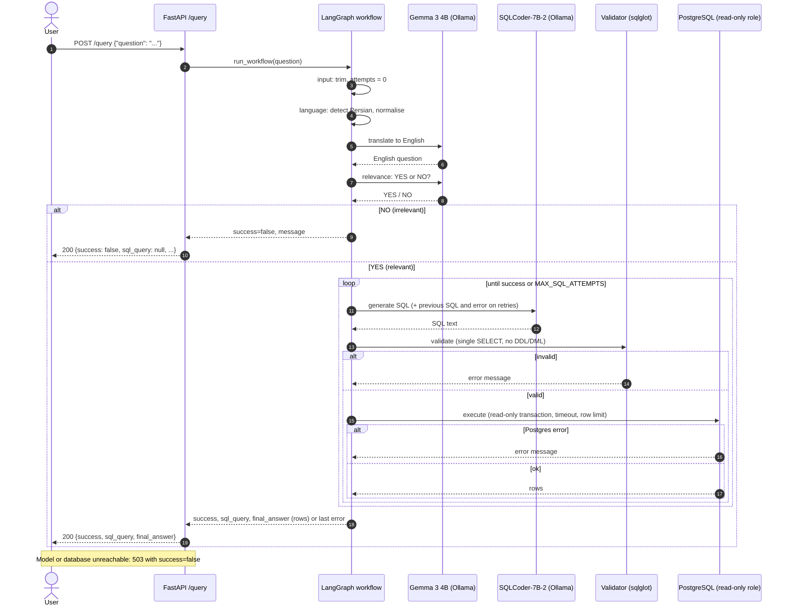

# QueryCraft

Ask a question about the database in **Persian or English**; the API writes the PostgreSQL query, runs it, and returns the SQL and the rows.

```
POST /query   {"question": "گران‌ترین محصول فروخته شده چیست؟"}
→ {"success": true, "sql_query": "SELECT ...", "final_answer": [{"name": "...", "price": 1482.33}]}
```

## Architecture

A LangGraph workflow (`app/workflow/`) owns the routing, shared state and the correction loop:

```
input → language → relevance ──no──→ respond
                       │yes
                       ▼
            ┌───→ generate → validate ──invalid──┐
            │                   │valid           │
            │                   ▼                ▼
            │                execute ──error──→ correct ──max attempts──→ respond
            │                   │ok               │
            └───────────────────┼─────────────────┘
                                ▼
                             respond
```

| Node | What it does |
|---|---|
| language | Detects Persian by script, normalises it (Arabic letters, digits, half-spaces), translates to English with **Gemma** |
| relevance | **Gemma** answers YES/NO: can this be answered by a read-only SELECT on our schema? |
| generate | **SQLCoder-7B-2** writes the query; on retries the failing SQL and its error are in the prompt |
| validate | `sqlglot`: one statement, SELECT only; **only the app's own tables** (no `pg_*` / `information_schema` / table functions); no DDL/DML, `SELECT INTO`, `FOR UPDATE`, data-modifying CTEs; no `pg_*`/`lo_*`/`dblink`/`set_config`/`version`/`nextval`/`generate_series` functions |
| execute | `asyncpg` as a **read-only role**, read-only transaction, statement timeout, row limit |
| correct | Retry (max `MAX_SQL_ATTEMPTS`, default 3), then `success: false` with the last error |

### Request sequence

One `POST /query` for a Persian question that is relevant and needs one retry. English questions skip the translation call.



Database: three related tables (`ingestion/schema.sql`): `categories` ← `products` ← `order_items`; seeded with 1000 products and 5000 sales. The `ingestion` service creates the schema, seeds it and creates the read-only role `querycraft_ro`; it is idempotent.

Models: both are Q4_K_M-quantized and called through **LangChain** model wrappers (`app/sql/llm.py`). Everything runs locally. There are two ways to serve them:

- **`remote` (default):** an OpenAI-compatible server on the host, called with `langchain-openai`. The default is **Ollama** (`:11434`); plain llama.cpp `llama-server` also works.
- **`local`:** llama.cpp loaded in-process from a GGUF file, using `langchain-community` `LlamaCpp`/`ChatLlamaCpp`.

Gemma defaults to **CPU** and SQLCoder to the **GPU**, so two models never share GPU memory.

| Role | Model | Ollama model (`remote`) | GGUF file (`local`) |
|---|---|---|---|
| SQL generation | SQLCoder-7B-2 (Defog) | `pxlksr/defog_sqlcoder-7b-2:Q4_K_M` | `MaziyarPanahi/sqlcoder-7b-2-GGUF` · `sqlcoder-7b-2.Q4_K_M.gguf` |
| Translation, relevance | Gemma 3 4B instruct | `gemma3:4b` | `ggml-org/gemma-3-4b-it-GGUF` · `gemma-3-4b-it-Q4_K_M.gguf` |

The Ollama SQLCoder model is a community upload of the same v2 weights (Ollama's own `sqlcoder:7b` is v1). It was chosen because it can be pulled without Hugging Face access.

## Setup

1. `cp .env.example .env`, then edit it (change the passwords).
2. Prepare the models. With Ollama (the default) one script pulls the base models and creates the ones the app calls, with the GPU/CPU and context settings from `.env`:
   ```bash
   python -m venv .venv && source .venv/bin/activate
   pip install -r app/requirements.txt
   python -m app.scripts.setup_ollama            # or: ... sql | chat
   ```
   The GGUF files from Hugging Face (`python -m app.scripts.download_model`) are only needed for `local` mode or `llama-server`.
3. Start the stack.

### macOS (Apple Silicon, MPS): models on the host, app in Docker

Docker containers on macOS cannot use MPS, so the models run on the host in **Ollama** and the container calls its OpenAI-compatible API (`SQL_BACKEND=remote`, `GEMMA_BACKEND=remote`, the defaults). No Hugging Face download is needed.

```bash
python -m app.scripts.setup_ollama     # step 2: pulls the models and creates querycraft-sqlcoder / querycraft-gemma
docker compose up -d --build
```

Ollama must be running (`ollama serve`, or the desktop app).

**GPU/CPU placement.** Ollama's OpenAI-compatible API cannot choose GPU layers per request, so `setup_ollama` bakes `SQL_N_GPU_LAYERS` / `GEMMA_N_GPU_LAYERS` (as `num_gpu`) and `*_N_CTX` (as `num_ctx`) into the derived models. With the defaults SQLCoder runs fully on the GPU and Gemma on the CPU, so two models never share GPU memory; check with `ollama ps`. Re-run `setup_ollama` after changing those variables.

The model names come from `SQL_REMOTE_MODEL` / `GEMMA_REMOTE_MODEL` in `.env` (the derived models), and both URLs point at Ollama (`http://host.docker.internal:11434`). To use plain `llama-server` instead (needs the GGUF files from step 2), set the URLs to `:8080` / `:8081`, set `*_REMOTE_MODEL=local`, and run `app/scripts/run_llama_server.sh sql` and `... gemma` in two terminals.

### NVIDIA GPU (CUDA): everything in Docker

Needs the NVIDIA Container Toolkit. The image builds `llama-cpp-python` with CUDA and loads the models in-process.

```bash
docker compose -f docker-compose.yml -f docker-compose.cuda.yml up -d --build
```

### CPU only

Set `SQL_N_GPU_LAYERS=0` in `.env`, then use either option above.

### Without Docker for the app

`pip install -r app/requirements-local.txt` (Metal is built in on macOS; use `CMAKE_ARGS="-DGGML_CUDA=on"` for CUDA), set `SQL_BACKEND=local` and `GEMMA_BACKEND=local`, run `docker compose up -d postgres ingestion`, then `uvicorn app.main:app`. A one-off question: `python -m app.cli "most expensive product"`.

## Configuration (`.env`)

| Variable | Meaning | Default |
|---|---|---|
| `POSTGRES_*` | Database credentials (owner role, used by ingestion) | |
| `READONLY_USER/PASSWORD` | Role the API uses to run generated SQL | |
| `READONLY_STATEMENT_TIMEOUT` | Query time limit for that role | `5s` |
| `SQL_MAX_ROWS` | Max rows returned | `100` |
| `MAX_SQL_ATTEMPTS` | SQL generation attempts before giving up | `3` |
| `SQL_BACKEND` / `GEMMA_BACKEND` | `remote` (Ollama or llama-server) or `local` (llama-cpp-python in-process) | `remote` |
| `SQL_REMOTE_URL` / `GEMMA_REMOTE_URL` | Ollama or llama-server URLs | `http://host.docker.internal:11434` |
| `SQL_REMOTE_MODEL` / `GEMMA_REMOTE_MODEL` | Model name sent to the server (`local` for llama-server); with Ollama, the derived model `setup_ollama` creates | `querycraft-sqlcoder` / `querycraft-gemma` |
| `SQL_OLLAMA_BASE` / `GEMMA_OLLAMA_BASE` | Ollama model pulled and used as the base of the derived model | `pxlksr/defog_sqlcoder-7b-2:Q4_K_M` / `gemma3:4b` |
| `SQL_N_GPU_LAYERS` / `GEMMA_N_GPU_LAYERS` | Layers offloaded to GPU (`-1` all, `0` CPU). In `local` mode read by the app; with Ollama baked in by `setup_ollama` | `-1` / `0` |
| `SQL_N_CTX` / `GEMMA_N_CTX` | Context size (same as above) | `4096` / `2048` |
| `SQL_MODEL_DIR`, `*_MODEL_REPO`, `*_MODEL_FILE` | Where the GGUF weights are and which to download (`local` mode, `llama-server`) | `./models` |
| `METRICS_PORT` | Port of the Prometheus metrics server; `0` disables it | `9100` |
| `METRICS_PROBE_INTERVAL` | Seconds between model and database health probes | `30` |
| `LOG_LEVEL` | `DEBUG`, `INFO`, `WARNING` or `ERROR` | `INFO` |
| `LOG_FORMAT` | `json` (one object per line, for log collectors) or `text` (readable, for development) | `json` |
| `LOG_SENSITIVE` | `true` also logs user questions and generated SQL (see Logging) | `false` |
| `HF_ENDPOINT`, `HF_TOKEN` | Optional Hugging Face mirror and token for the download script | |

## Logging

Logs go to stderr as one JSON object per line (`LOG_FORMAT=text` for a readable form), configured in `app/logging_config.py`. Docker rotates them (10 MB x 5 files per service).

- **Request IDs:** every request gets an id (a valid incoming `X-Request-ID` header is reused, anything else is replaced). It is returned in the `X-Request-ID` response header and stamped on every log line, including the workflow, model calls and library logs, so one request can be followed with `docker compose logs app | grep <id>`.
- **What is logged:** `request` (method, path, status, duration), `query_received`, one `node_completed` per workflow node (duration and what it decided: language, relevance, attempts, row count, validation or SQL error kind), `model_call` (model, duration, prompt size), `query_completed` (success, attempts, failure reason, total duration), `db_pool_created`, `service_started`. Failures log a traceback (`node_failed`, `workflow_failed`, `request_failed`, `model_call_failed`).
- **Privacy:** passwords and tokens are never logged. User questions, translations, generated SQL and database error text are **not** logged either, only their lengths and the error class, because they can contain personal data. Set `LOG_SENSITIVE=true` to include them while debugging.

```json
{"timestamp": "2026-11-07T16:14:03.2+00:00", "level": "INFO", "logger": "querycraft.workflow", "message": "node_completed", "request_id": "demo-001", "node": "generate", "duration_ms": 442.1, "attempts": 1, "sql_chars": 50}
```

## Metrics (Prometheus)

Metrics are served in Prometheus text format on their own port, `http://localhost:9100/metrics` (published on localhost only), so the API itself stays a single `POST /query`. Run a single uvicorn worker (or enable `prometheus_client` multiprocess mode), otherwise each worker exposes its own counters.

### Prometheus and Grafana

`docker-compose-minitoring.yml` adds Prometheus and Grafana. Start it together with the main file so they share a network:

```bash
docker compose -f docker-compose.yml -f docker-compose-minitoring.yml up -d
```

| | URL | Notes |
|---|---|---|
| Grafana | http://localhost:3000 | user `admin`, password `GRAFANA_ADMIN_PASSWORD` from `.env`; the **QueryCraft** dashboard (29 panels) and the Prometheus datasource are provisioned |
| Prometheus | http://localhost:9090 | scrapes `app:9100` every 15 s; 8 alert rules from `monitoring/alerts.yml` (failure rate, SQL quality, latency, model/database down, validator spikes, statement timeouts, scrape down); 15 days of data |

Both ports are published on localhost only. Files live in `monitoring/` (`prometheus.yml`, `alerts.yml`, `grafana/provisioning/`, `grafana/dashboards/querycraft.json`). To run Prometheus directly on the host instead, change the scrape target in `monitoring/prometheus.yml` to `localhost:9100`. Alert rules only record state here; add Alertmanager to send notifications.

| Group | Metrics (prefix `querycraft_`) |
|---|---|
| API | `http_requests_total{method,path,status}`, `http_request_duration_seconds{method,path}`, `http_requests_in_progress` |
| Questions | `queries_total{outcome,language}` (outcome `success`/`irrelevant`/`failed`/`error`), `query_failures_total{reason}` (`validation`, `execution`, `model_error`, `db_error`, `internal`), `query_attempts`, `query_duration_seconds{outcome}`, `result_rows`, `result_truncated_total` |
| Workflow | `node_duration_seconds{node}`, `node_errors_total{node}`, `correction_loops_total{trigger}` (`validation`/`execution`) |
| Models | `model_calls_total{model,kind,status}`, `model_call_duration_seconds{model,kind}`, `model_prompt_chars{model}`, `model_up{model}` |
| SQL safety | `validation_rejections_total{rule}` (`syntax`, `multi_statement`, `not_select`, `forbidden_table`, `forbidden_node`, `forbidden_function`), `relevance_rejections_total` |
| Database | `db_query_duration_seconds`, `db_query_errors_total{error_class}`, `db_statement_timeouts_total`, `db_pool_size`, `db_pool_idle`, `db_up` |
| Build | `build_info{version,sql_model,chat_model,sql_backend}` (set `APP_VERSION`), plus the standard `process_*` and `python_*` metrics |

`model_up` and `db_up` come from a background probe (every `METRICS_PROBE_INTERVAL` seconds), and `model_up` is also updated by every real model call, so an outage shows up even when nobody is asking questions. Label values are always from small fixed sets; questions, SQL and request ids are never used as labels. Useful queries:

```promql
sum(rate(querycraft_queries_total{outcome=~"failed|error"}[5m])) / sum(rate(querycraft_queries_total[5m]))   # failure ratio
histogram_quantile(0.95, sum by (le) (rate(querycraft_query_attempts_bucket[15m])))                         # SQL quality: retries needed
histogram_quantile(0.95, sum by (le, node) (rate(querycraft_node_duration_seconds_bucket[5m])))             # which stage is slow
```

## Tests

```bash
pip install -r app/requirements-dev.txt
docker compose up -d postgres ingestion    # tests use the real, seeded database
python -m pytest
```

The default suite replaces the language models with deterministic fakes, so no weights or Ollama are needed; the validator, LangGraph workflow, FastAPI app and PostgreSQL are real. The suite covers Persian vs. English, a three-table JOIN, GROUP BY, irrelevant and destructive questions, a forced SQL error with the correction loop, and the retry cap. Tests skip themselves if PostgreSQL is not reachable.

**Live tests** run the real Gemma and SQLCoder through Ollama (English and Persian questions, a count, a three-table JOIN with aggregation, a sold-products question, and irrelevant/destructive requests). They are opt-in, take about 20 s, and compare the answers with reference SQL run on the same database, not with the model's SQL text:

```bash
python -m app.scripts.setup_ollama
python -m pytest -m live
```
They skip themselves if Ollama or the models are missing. Use them after changing the prompt, the models or their quantization.

## Limits and notes

- Only the SQL model may be external per the assignment; both models here are local.
- Prompt hints improve a 7B model but do not guarantee correct SQL. Run `python -m pytest -m live` after changes to catch regressions.
- Dependencies are pinned two ways: version ranges in `requirements.txt`, and exact versions in `app/requirements.lock` and `ingestion/requirements.lock`, which the Dockerfiles apply as pip constraints. Regenerate a lock file from a working image with `docker compose exec -T app pip freeze | sort -f` (see the header of each file). `llama-cpp-python` (local mode only) is not locked, because it compiles from source per platform.
- The Docker image installs Python packages from `https://pypi.mydigipay.info/simple` (see `app/Dockerfile`). Remove `--index-url` there if you build outside that network.
- Blocking inference runs in a worker thread (`local`) or over HTTP (`remote`), so the event loop is never blocked.
- The model prompts read their schema from `ingestion/schema.sql` at import time (the app image copies that file), so there is one source of truth. Put hints for the model in SQL comments there.
- Model outage or an unreachable database returns HTTP 503 with `success: false`.
