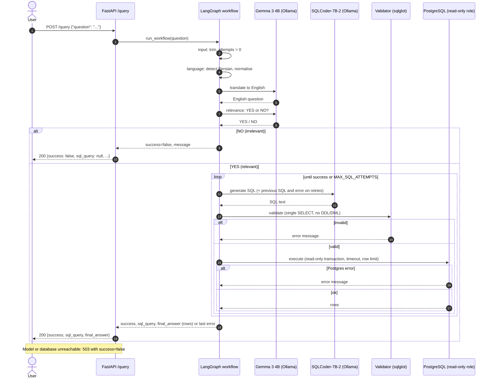

# QueryCraft

Ask a question about the database in **Persian or English**; the API writes the PostgreSQL query, runs it, and returns the SQL and the rows.

```
POST /query   {"question": "گران‌ترین محصول فروخته شده چیست؟"}
→ {"success": true, "sql_query": "SELECT ...", "final_answer": [{"name": "...", "price": 1482.33}]}
```

## Architecture

A LangGraph workflow (`app/workflow/`) owns the routing, shared state and the correction loop:

```
input → language → relevance ──no──→ respond
                       │yes
                       ▼
            ┌───→ generate → validate ──invalid──┐
            │                   │valid           │
            │                   ▼                ▼
            │                execute ──error──→ correct ──max attempts──→ respond
            │                   │ok               │
            └───────────────────┼─────────────────┘
                                ▼
                             respond
```

| Node | What it does |
|---|---|
| language | Detects Persian by script, normalises it (Arabic letters, digits, half-spaces), translates to English with **Gemma** |
| relevance | **Gemma** answers YES/NO: can this be answered by a read-only SELECT on our schema? |
| generate | **SQLCoder-7B-2** writes the query; on retries the failing SQL and its error are in the prompt |
| validate | `sqlglot`: one statement, SELECT only; no DDL/DML, `SELECT INTO`, `FOR UPDATE`, data-modifying CTEs, `pg_*`/`lo_*`/`dblink`/`set_config` functions |
| execute | `asyncpg` as a **read-only role**, read-only transaction, statement timeout, row limit |
| correct | Retry (max `MAX_SQL_ATTEMPTS`, default 3), then `success: false` with the last error |

### Request sequence

One `POST /query` for a Persian question that is relevant and needs one retry. English questions skip the translation call.



Database: three related tables (`ingestion/schema.sql`): `categories` ← `products` ← `order_items`; seeded with 1000 products and 5000 sales. The `ingestion` service creates the schema, seeds it and creates the read-only role `querycraft_ro`; it is idempotent.

Models: both are Q4_K_M-quantized and called through **LangChain** model wrappers (`app/sql/llm.py`). Everything runs locally. There are two ways to serve them:

- **`remote` (default):** an OpenAI-compatible server on the host, called with `langchain-openai`. The default is **Ollama** (`:11434`); plain llama.cpp `llama-server` also works.
- **`local`:** llama.cpp loaded in-process from a GGUF file, using `langchain-community` `LlamaCpp`/`ChatLlamaCpp`.

Gemma defaults to **CPU** and SQLCoder to the **GPU**, so two models never share GPU memory.

| Role | Model | Ollama model (`remote`) | GGUF file (`local`) |
|---|---|---|---|
| SQL generation | SQLCoder-7B-2 (Defog) | `pxlksr/defog_sqlcoder-7b-2:Q4_K_M` | `MaziyarPanahi/sqlcoder-7b-2-GGUF` · `sqlcoder-7b-2.Q4_K_M.gguf` |
| Translation, relevance | Gemma 3 4B instruct | `gemma3:4b` | `ggml-org/gemma-3-4b-it-GGUF` · `gemma-3-4b-it-Q4_K_M.gguf` |

The Ollama SQLCoder model is a community upload of the same v2 weights (Ollama's own `sqlcoder:7b` is v1). It was chosen because it can be pulled without Hugging Face access.

## Setup

1. Edit `.env` (change the passwords).
2. Get the models. Pick the option for your hardware below. With Ollama (the default) this is two `ollama pull` commands; the GGUF files from Hugging Face are only needed for `local` mode or `llama-server`:
   ```bash
   python -m venv .venv && source .venv/bin/activate
   pip install -r app/requirements.txt
   python -m app.scripts.download_model          # optional; or: ... sql | chat. Needs access to Hugging Face
   ```
3. Start the stack.

### macOS (Apple Silicon, MPS): models on the host, app in Docker

Docker containers on macOS cannot use MPS, so the models run on the host in **Ollama** and the container calls its OpenAI-compatible API (`SQL_BACKEND=remote`, `GEMMA_BACKEND=remote`, the defaults). No Hugging Face download is needed.

```bash
ollama pull pxlksr/defog_sqlcoder-7b-2:Q4_K_M
ollama pull gemma3:4b
docker compose up -d --build
```

Ollama must be running (`ollama serve`, or the desktop app).

The model names come from `SQL_REMOTE_MODEL` / `GEMMA_REMOTE_MODEL` in `.env`, and both URLs point at Ollama (`http://host.docker.internal:11434`). To use plain `llama-server` instead (needs the GGUF files from step 2), set the URLs to `:8080` / `:8081`, set `*_REMOTE_MODEL=local`, and run `app/scripts/run_llama_server.sh sql` and `... gemma` in two terminals.

### NVIDIA GPU (CUDA): everything in Docker

Needs the NVIDIA Container Toolkit. The image builds `llama-cpp-python` with CUDA and loads the models in-process.

```bash
docker compose -f docker-compose.yml -f docker-compose.cuda.yml up -d --build
```

### CPU only

Set `SQL_N_GPU_LAYERS=0` in `.env`, then use either option above.

### Without Docker for the app

`pip install -r app/requirements-local.txt` (Metal is built in on macOS; use `CMAKE_ARGS="-DGGML_CUDA=on"` for CUDA), set `SQL_BACKEND=local` and `GEMMA_BACKEND=local`, run `docker compose up -d postgres ingestion`, then `uvicorn app.main:app`. A one-off question: `python -m app.cli "most expensive product"`.

## Configuration (`.env`)

| Variable | Meaning | Default |
|---|---|---|
| `POSTGRES_*` | Database credentials (owner role, used by ingestion) | |
| `READONLY_USER/PASSWORD` | Role the API uses to run generated SQL | |
| `READONLY_STATEMENT_TIMEOUT` | Query time limit for that role | `5s` |
| `SQL_MAX_ROWS` | Max rows returned | `100` |
| `MAX_SQL_ATTEMPTS` | SQL generation attempts before giving up | `3` |
| `SQL_BACKEND` / `GEMMA_BACKEND` | `remote` (Ollama or llama-server) or `local` (llama-cpp-python in-process) | `remote` |
| `SQL_REMOTE_URL` / `GEMMA_REMOTE_URL` | Ollama or llama-server URLs | `http://host.docker.internal:11434` |
| `SQL_REMOTE_MODEL` / `GEMMA_REMOTE_MODEL` | Model name sent to the server (`local` for llama-server) | `pxlksr/defog_sqlcoder-7b-2:Q4_K_M` / `gemma3:4b` |
| `SQL_N_GPU_LAYERS` / `GEMMA_N_GPU_LAYERS` | Layers offloaded to GPU (`-1` all, `0` CPU); `local` mode only. With Ollama, GPU use is managed by Ollama | `-1` / `0` |
| `SQL_N_CTX` / `GEMMA_N_CTX` | Context size; `local` mode only | `4096` / `2048` |
| `SQL_MODEL_DIR`, `*_MODEL_REPO`, `*_MODEL_FILE` | Where the GGUF weights are and which to download (`local` mode, `llama-server`) | `./models` |
| `HF_ENDPOINT`, `HF_TOKEN` | Optional Hugging Face mirror and token for the download script | |

## Tests

```bash
pip install -r app/requirements-dev.txt
docker compose up -d postgres ingestion    # tests use the real, seeded database
python -m pytest
```

The language models are replaced by deterministic fakes, so no weights or Ollama are needed; the validator, LangGraph workflow, FastAPI app and PostgreSQL are real. The suite covers Persian vs. English, a three-table JOIN, GROUP BY, irrelevant and destructive questions, a forced SQL error with the correction loop, and the retry cap. Tests skip themselves if PostgreSQL is not reachable.

## Limits and notes

- Only the SQL model may be external per the assignment; both models here are local.
- The tests do not exercise the real models. Check translation quality and SQL correctness (JOINs, `GROUP BY`) manually against Ollama after setup.
- The Docker image installs Python packages from `https://pypi.mydigipay.info/simple` (see `app/Dockerfile`). Remove `--index-url` there if you build outside that network.
- Blocking inference runs in a worker thread (`local`) or over HTTP (`remote`), so the event loop is never blocked.
- The model prompts read their schema from `ingestion/schema.sql` at import time (the app image copies that file), so there is one source of truth. Put hints for the model in SQL comments there.
- Model outage or an unreachable database returns HTTP 503 with `success: false`.
